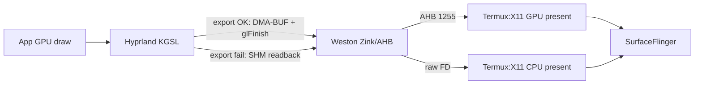

# Y900 그래픽 가속 다음 단계 — 2026-10-19

목적: Lenovo Y900(TB522FU / Snapdragon 8 Elite / Adreno) Termux Omarchy 스택에서, 이미 확인된 경계 위에 **다음 1–2주 ROI가 큰 실험**만 남긴다. GPU renderer 문자열·하드웨어 decoder 이름 확장을 목표로 하지 않는다.

증거 표기: **[계약]** = 소스/런처가 요청하거나 허용하는 동작. **[실측]** = 이 기기·세션에서 관측한 사실. 둘을 섞어 쓰지 않는다.

선행: [2026-10-12 가속 조사](2026-10-12-y900-graphics-acceleration.md), [X11 AHB 구현](2026-10-12-y900-x11-copy-implementation.md), [native browser/fence](2026-10-12-native-browser-performance.md), [Android 브리지 선례](android-graphics-bridges.md), [검증: fence](../validation/2026-10-12-native-fence-desktop.md), [검증: scroll](../validation/2026-10-12-scroll-responsiveness.md), `experiments/termux-x11-ahb-wsi/`, `experiments/xshmfence-futex/`, `termux/omarchy_commands.py`.

## 2026-10-19 live 세션 기준점 (실측 보고)

부모 작업이 같은 날 읽은 환경. 이 문서의 재측정이 아니다.

| 계층 | 보고된 설정 |
| --- | --- |
| Display | 3840×2560 요청, refresh 120000 mHz, Hyprland scale 2.5 |
| Termux:X11 | Android Surface 최종 표시 |
| native Weston | `GALLIUM_DRIVER=zink`, `MESA_LOADER_DRIVER_OVERRIDE=zink`, VK ICD under `graphics-ahb` |
| PRoot Hyprland | `MESA_LOADER_DRIVER_OVERRIDE=kgsl`, `HYPRLAND_ANDROID_DMABUF=1`, `HYPRLAND_GL_DMABUF_EXPORT=1`, `FD_KGSL_ENABLE_DMABUF=1`, `AQ_ANDROID_DMABUF_*=0` |

런처 계약은 [`termux/omarchy_commands.py`](../../termux/omarchy_commands.py)와 일치한다. `graphics-ahb/selection.json`이 있으면 Weston에만 `LOOPY_X11_AHB=1` + private Turnip ICD + scoped `LD_PRELOAD` of system binder/nativewindow를 넣는다. [설치 경계](../../termux/omarchy_graphics_install.py) (driver SHA `7f05d872…`).

## 1. End-to-end 버퍼 경로와 남은 복사

```text
[guest apps]
  Chromium (native bionic, ANGLE/Vulkan, MAILBOX) ──X11/DRI3──► guest Xwayland
  Code serve-web UI (same native Chromium)                 │
  other Wayland clients (KGSL Mesa) ──wl_shm / linux-dmabuf──┤
                                                             ▼
                                              PRoot Hyprland (KGSL GLES)
                                   HYPRLAND_GL_DMABUF_EXPORT=1 요청 시
                                   staging FBO → eglExportDMABUF* 또는 SHM readback
                                                             │
                                                             ▼ wl_surface commit
                                              native Weston (Zink→Turnip)
                                   graphics-ahb 시 AHB DRI3 modifier 1255
                                                             │
                                                             ▼ Present
                                              Termux:X11 LorieNative
                                   AHB: GPU present copy / flip 후보
                                   raw FD: CPU present / texSubImage 후보
                                                             ▼
                                              Android SurfaceFlinger
```

### 계층별 GPU vs CPU (계약 vs 실측)

| 경계 | 무엇이 일어나는가 | 증거 종류 |
| --- | --- | --- |
| App GL/Vulkan → Hyprland | Turnip/KGSL 렌더 **[계약+부분 실측]** (`GL_RENDERER`/compositing enabled는 부분 증거) | [native fence 검증](../validation/2026-10-12-native-fence-desktop.md) |
| Hyprland → Weston | `HYPRLAND_GL_DMABUF_EXPORT=1`이면 EGL export DMA-BUF 시도; 실패 시 SHM + `glReadPixels`/BGRA **[계약]** | BlackFireAlex v0.1.1 [KGSL presentation patch](https://github.com/BlackFireAlex/omarchy-android/blob/c189d33bf34a7a50fad3ff46bbd97e5c29b48910/patches/hyprland/0001-render-carry-proven-Android-KGSL-presentation-path.patch); Loopy `LoopyShmReadback.cpp`는 SHM 전용 경로 |
| Aquamarine allocator | `AQ_ANDROID_DMABUF_VULKAN/HEAP=0`이면 Wayland에서 **SHM allocator**가 primary **[계약]** | 로컬 pin [aquamarine KGSL patch](../../build/omarchy-v011-source/patches/aquamarine/0001-wayland-carry-proven-Android-KGSL-buffer-pipeline.patch) `Backend.cpp` |
| Export 성공 시 sync | export path는 `glFinish()` 후 parent에 샘플링 허용; “native-fence hand-off는 다음 최적화” 주석 **[계약]** | 위 Hyprland patch `GLRenderbuffer::unbind` |
| Weston → Termux:X11 (stock Turnip raw FD) | DRI3 raw FD → Present GPU offload **0/N** **[실측 2026-10-12]** | [가속 조사](2026-10-12-y900-graphics-acceleration.md) `0/294 present copies offloaded to GPU` |
| Weston → Termux:X11 (AHB WSI) | modifier 1255 AHB → **297/297 present copies offloaded to GPU** **[실측]** | [X11 copy 구현](2026-10-12-y900-x11-copy-implementation.md); [experiment README](../../experiments/termux-x11-ahb-wsi/README.md) |
| Termux:X11 Present flip | imported raw FD flip 기본 거부; `TERMUX_X11_FORCE_FLIP=1`만 우회 **[계약]** | [Termux:X11 InitOutput.c](https://github.com/termux/termux-x11/blob/dd2e1d6d/app/src/main/cpp/lorie/InitOutput.c) `loriePresentFlip` |
| Chromium → Xwayland (no glamor) | `XWAYLAND_NO_GLAMOR=1`이면 DRI3 없음 → Chromium Vulkan surface 거절 → Skia X11 `readPixels` 가능 **[계약]** | [X11 copy 구현 §Chromium](2026-10-12-y900-x11-copy-implementation.md); [SkiaOutputDeviceX11](https://github.com/chromium/chromium/blob/main/components/viz/service/display_embedder/skia_output_device_x11.cc) |
| Native Chromium + private Xwayland KGSL | DRI3/GaneshVulkan 경로로 Present 진행; futex fence ABI 수정 후 4K 동시작업 통과 **[실측]** | [native-fence-desktop](../validation/2026-10-12-native-fence-desktop.md) |
| VA decode → compositor | MediaCodec→SHM→VA surface CPU sync; batch sync로 처리시간↓해도 drop률 미개선 **[실측]** | [가속 조사](2026-10-12-y900-graphics-acceleration.md); [VA batch README](../../experiments/termux-va-batch-sync/README.md) |

**핵심 판정:** Weston/Hyprland가 Turnip/KGSL을 쓴다는 사실만으로 Android Surface까지 zero-copy라고 말할 수 없다. last-mile Present는 AHB 설치 전 **CPU copy가 실측**됐고, AHB 설치 후 GPU present copy로 바뀐 **별도 실측**이 있다.

### 2026-10-19 AHB Present 재확인 **[실측]**

세션 `22183934-c4fb-458d-bb99-0be8af3d7552` (HiDPI 2.5, `LOOPY_X11_AHB=1`, Weston `VK_ICD_FILENAMES=…/graphics-ahb/icd.json`):

```
LorieNative: 584 frames in 5.0 seconds = 116.8 FPS, 306/306 present copies offloaded to GPU
```

last-mile Present GPU offload는 **유지 중**이다. 따라서 체감 버벅임의 다음 의 후보는 Termux:X11 Present CPU copy가 아니라 **Hyprland→Weston export vs SHM readback**, 메모리/swap 압박, PRoot/syscall, 또는 앱(Chromium) 경로다. `termux-x11`의 높은 kernel CPU는 AHB GPU present와 공존할 수 있으며(fence/binder/스케줄), Present offload=0의 증거로 재해석하지 않는다.



## 2. 후보 평가 (요청 목록)

### A. Termux:X11 AHB WSI / custom AHB import — **유지·회귀 감시 1순위**

| 항목 | 내용 |
| --- | --- |
| 가설 | private Turnip X11 WSI가 AHB를 할당·1255로 보내면 Present GPU offload가 유지되고 last-mile CPU copy가 없다 |
| 이미 된 것 | opt-in 패치·설치·동적 색/stride 시험·Omarchy `297/297` **[실측]**; 코드: `experiments/termux-x11-ahb-wsi/` |
| 남은 것 | ✅ 2026-10-19 live 재확인 `306/306` (위 §재확인). 이후: resize/회전/장기 세션; AHB 없이도 동작하는 fallback 문서화 |
| HiDPI/세션 위험 | Weston만 private ICD; guest/Hyprland 설정 비변경. 잘못된 `LD_LIBRARY_PATH` 전부 system 우선 시 guest DMA-BUF import 붕괴 **[계약/과거 실측 crash]** |
| Rollback | `graphics-ahb/` rename 또는 selection 제거 → stock Termux Turnip ICD (CPU present로 회귀 가능) |

Android AHB API: [NDK AHardwareBuffer](https://developer.android.com/ndk/reference/group/a-hardware-buffer). Termux custom modifier 1255 수신: [InitOutput.c / buffer.c](https://github.com/termux/termux-x11/blob/fa3a8b430e2896a19f44c99a9cb056254615ae06/lorie/src/main/cpp/lorie/InitOutput.c).

### B. Weston→X11 present flip / `TERMUX_X11_FORCE_FLIP` — **지금 ROI 낮음; AHB 실패 시에만**

| 항목 | 내용 |
| --- | --- |
| 가설 | flip이 Present copy보다 싸면 cadence/CPU가 줄어든다 |
| 소스 계약 | imported **raw FD** flip은 Turnip 문제로 기본 FALSE; env=`1`일 때만 허용. AHB/regular 경로는 별도 분기 | [loriePresentFlip](https://github.com/termux/termux-x11/blob/dd2e1d6d/app/src/main/cpp/lorie/InitOutput.c) |
| 판정 | AHB가 N/N GPU copy를 유지하는 한 flip 강제 실험은 **비목표**. raw FD로 되돌아간 세션에서만 CPU copy bytes와 flip 손상(tear/stale)을 A/B |
| 위험 | “does not work fine with turnip” 주석 그대로; HiDPI resize에서 root≠pixmap 크기면 flip 자체 FALSE |
| Rollback | env unset |

### C. Hyprland dmabuf-export vs SHM fallback — **계측 최우선 (현재 binary)**

| 항목 | 내용 |
| --- | --- |
| 가설 | 4K×2.5에서 export 실패→전프레임 SHM readback이면 scroll/video deadline을 먹는다; export 성공이면 `glFinish` 비용만 남는다 |
| 소스 계약 | SHM output + `HYPRLAND_GL_DMABUF_EXPORT`: `eglExportDMABUFImage*`; 성공 시 `setPresentationDMABUF`, 실패 시 SHM readback + optional `HYPRLAND_SHM_PROFILE` 평균 us/KiB | [KGSL presentation patch](https://github.com/BlackFireAlex/omarchy-android/blob/c189d33bf34a7a50fad3ff46bbd97e5c29b48910/patches/hyprland/0001-render-carry-proven-Android-KGSL-presentation-path.patch) |
| 반증 측정 | 현재 설치 Hyprland 로그에서 `GPU presentation export ready` vs `invalid…retaining SHM`; 또는 `HYPRLAND_SHM_PROFILE=1`로 120프레임 집계. **재빌드 전** strings/`/proc/<pid>/environ`으로 flag·바이너리 provenance 확인 ([과거 provenance 공백](2026-10-12-native-browser-performance.md)) |
| 위험 | PROFILE 로그 I/O가 측정 왜곡; main 세션 env를 바꾸지 말고 짧은 trial 후 원복 |
| Rollback | PROFILE=0; 코드 변경 없음 |

### D. Chromium native Wayland vs Xwayland (`XWAYLAND_NO_GLAMOR`) — **browser 전용, 범위 좁게**

| 항목 | 내용 |
| --- | --- |
| 가설 | Xwayland CPU/glamor 부재 경계가 browser 병목이면 native Wayland가 drop/rAF를 줄인다 |
| 제약 | 공식 Termux Chromium recipe는 `ozone_platform_wayland=false` **[계약]** → native Termux 패키지로는 guest Wayland 직결 불가 | [native browser 조사](2026-10-12-native-browser-performance.md) |
| 기존 실측 | guest Wayland+ANGLE 조합은 software compositor / 색오류 / 높은 drop으로 다수 기각; private Xwayland KGSL+v3가 native X11 경로를 연 상태 | [X11 copy 구현 후속](2026-10-12-y900-x11-copy-implementation.md), [native-fence](../validation/2026-10-12-native-fence-desktop.md) |
| 다음 허용 실험 | (1) **현재 native X11+MAILBOX baseline 유지**; (2) guest Chromium Wayland는 별도 profile·동일 1080p60+편집에서만 A/B; (3) main `XWAYLAND_NO_GLAMOR` 해제 금지 until nested glamor gate |
| 위험 | IME/clipboard/resize 회귀; main 세션 glamor 켜면 기존 KGSL presentation과 충돌 가능 |
| Rollback | 실험 profile 삭제; main env 불변 |

### E. native fence / libxshmfence — **완료된 것 vs 남음**

| 상태 | 내용 |
| --- | --- |
| **완료 [실측]** | native Chromium↔guest Xwayland 공유 fence ABI: Termux `--disable-futex`(pthread 96B) vs guest futex(4B). private futex lib를 **browser LD_LIBRARY_PATH만**; 80-cycle interop PASS; 4K YouTube+Web Code 0.7934% drop | [xshmfence README](../../experiments/xshmfence-futex/README.md), [fence validation](../validation/2026-10-12-native-fence-desktop.md) |
| **남음 [계약/미실측]** | Hyprland export 경로의 `glFinish` → **EGL_ANDROID_native_fence_sync / sync_file hand-off**; Aquamarine `AQ_ANDROID_DMABUF_GLFINISH`와 동일한 “implicit fence 부재” 진단 스위치; Xwayland KGSL **implicit_sync 실제성** (rootful 픽셀 ≠ rootless Present) | Hyprland/Aquamarine patch 주석; [Xwayland24.1.13](https://www.x.org/releases/individual/xserver/xwayland-24.1.13.tar.xz) |
| 비목표 | Weston/Termux:X11 system libxshmfence 교체; fence 대기 제거로 “성능” 만들기 |

### F. `AQ_ANDROID_DMABUF_VULKAN/HEAP=0` — **의도적; 켜려면 allocator A/B**

| 항목 | 내용 |
| --- | --- |
| 의도 | 런처가 세 플래그를 `'0'`으로 고정. Aquamarine Android 패치는 VULKAN→HEAP→**SHM** 순으로 primary allocator 선택. 둘 다 off면 SHM **[계약]** | [`omarchy_commands.py`](../../termux/omarchy_commands.py); [aquamarine patch Backend.cpp](../../build/omarchy-v011-source/patches/aquamarine/0001-wayland-carry-proven-Android-KGSL-buffer-pipeline.patch) |
| `HEAP=1` 요구 | parent가 linear DMA-BUF를 받고 `/dev/dma_heap/*` 할당이 guest에서 성공; SELinux/UID; Weston import 성공; SHM fallback count 유지 | [Android DMA-BUF heaps](https://source.android.com/docs/core/architecture/kernel/dma-buf-heaps) |
| `VULKAN=1` 요구 | `CVulkanAllocator` + 동일 linear dmabuf 지원; Turnip/KGSL external memory; 실패 시 HEAP/SHM |
| `GLFINISH=1` | DMA-BUF commit 전 `glFinish` — sync 진단용; 성능 기본값 아님 **[계약 주석]** |
| 판정 | Hyprland **export 성공률**을 먼저 재고, allocator를 SHM→HEAP로 바꾸는 것은 **별도 후보**. 둘을 동시에 바꾸지 말 것 |
| Rollback | 세 플래그 `0` 복귀 + 세션 재시작 |

upstream stock Aquamarine env 문서에는 이 Android 플래그가 없다([docs/env.md](https://github.com/hyprwm/aquamarine/blob/main/docs/env.md)) — Omarchy Android 패치 전용이다.

## 3. 순위가 매겨진 다음 실험 (ROI)

| 순위 | 실험 | 가설 | 반증 가능한 측정 | HiDPI/세션 위험 | Rollback |
| ---: | --- | --- | --- | --- | --- |
| **1** | AHB Present 회귀 확인 | live `graphics-ahb`가 여전히 GPU present | LorieNative `present copies offloaded to GPU` ≥95% over ≥5s idle+scroll; import log AHB≠rawFD | 읽기 전용 로그 | 없음 |
| **2** | Hyprland export vs SHM 계측 | export 실패가 4K CPU 병목 | export ready 로그 비율; `HYPRLAND_SHM_PROFILE` avg us & KiB; 동일 scroll rAF/video drop | PROFILE 짧은 trial | PROFILE=0 |
| **3** | Export 성공 시 native-fence 후보 | `glFinish`가 deadline을 먹는다 | fence/sync_file hand-off 후 finish 제거 A/B: drop·rAF·corrupt frame | compositor sync 깨짐→stale | 후보 binary만 교체 |
| **4** | AQ HEAP 단독 opt-in | SHM allocator가 export와 충돌/비용 | `HEAP=1`만, VULKAN=0; Weston import type; export 비율; pixel gate | allocator 실패 시 시작 불가 | flags=`0` |
| **5** | Browser Chromium trace (Notion scroll) | browser main vs swap-throttle vs 외부 present | 8–10s metadata trace: BeginFrame 8.33ms? pending_swaps? root missing? | trace overhead | 측정만 |
| **6** | guest Chromium Wayland A/B | Xwayland 경계만 비용 | 동일 decoder/GL/viewport; drop+IME+clipboard; xwayland=false | IME/입력 | X11 profile |
| **7** | `TERMUX_X11_FORCE_FLIP` | raw FD 세션에서만 flip이 CPU copy보다 낫다 | AHB off 실험 세션에서만; tear/stale/resize | 화면 손상 | unset |
| **8** | VA / MediaCodec AHB decode | HW decode가 SW보다 나음 | 이미 SW 우세 **[실측]**; 기본 승격 금지 | 화질/stale surface | 기존 SW |

## 4. 비목표 / 함정

- **`GL_RENDERER=Adreno` / Turnip 문자열 = end-to-end GPU.** compositor·Present·Surface 경계를 건너뛴 주장.
- **VA/MediaCodec 기본화.** 동일 세션에서 SW drop < VA drop이 이미 관측됨; batch sync는 처리시간만 줄임.
- **HiDPI scale 2.5→↓를 “GPU 가속”으로 포장.** 픽셀 수 감소는 가속이 아니라 해상도 타협.
- **`--enable-zero-copy`를 Chromium GPU raster 만능으로.** GPU raster 경로에서는 tile provider가 바뀌지 않음 **[계약]** ([refresh/queue 조사](2026-10-12-y900-refresh-queue-latency.md)).
- **AHB Present 성공 = YouTube/편집 완료.** AHB 이후에도 video+edit drop은 별도 축.
- **Weston system Vulkan 전역 교체 / SELinux 해제 / fence 대기 삭제.**
- **main 세션 `XWAYLAND_NO_GLAMOR=0`을 계측 없이 해제.**
- **공식 Termux Chromium에 `--ozone-platform=wayland`만 추가.** Wayland frontend 미빌드.

## 5. 1–2주 연구 계획과 수락 기준

전제: 3840×2560 / 120Hz / scale 2.5 / native Chromium MAILBOX / software H.264 유지. 입력·IME·clipboard 회귀 시 해당 후보 즉시 기각.

| Day | 작업 | 수락 / 기각 |
| --- | --- | --- |
| 1 | AHB Present 카운트 + import 유형 로그 수집 (idle 5s ×3, scroll 중 ×3) | GPU offload ≥95%면 last-mile 닫힌 것으로 표시; <50%면 AHB install/ICD drift 조사 우선 |
| 1–2 | 설치 Hyprland SHA/strings/`HYPRLAND_*` environ; export ready vs SHM profile 집계 | export 성공률·SHM KiB/frame 수치 확보 (추측 금지) |
| 3–4 | export 실패가 크면: provenance 맞는 소스에서 로그만 보강된 후보 빌드. 성공이 크면: native-fence 설계만 (구현은 gate 후) | SHM avg가 스크롤 p95와 상관 없으면 export를 병목에서 제외 |
| 4–5 | Notion 8–10s Chromium trace (cc,viz,gpu,input) + 기존 rAF/present 병행 | main vs swap-throttle vs 외부 경로 분기; zero-copy/image-count 동시 변경 금지 |
| 5–7 | 분기 결과에 따라 **하나만**: (a) Hyprland fence hand-off 후보, 또는 (b) `AQ_ANDROID_DMABUF_HEAP=1` 단독, 또는 (c) guest Wayland browser profile | 동일 fixture에서 video drop·rAF p95·IME 샘플 |
| 8–10 | 채택 후보만 3회 반복 + stop/start 1회; 실패 시 rollback receipt | 아래 수락표 |

### 수락 기준 (채택 시 모두)

1. **Present:** AHB 경로에서 GPU offload 비율 baseline 대비 유지 또는 개선 (회귀 없음).
2. **Frame drop:** YouTube 1080p60 + 가시 영역≥0.95 동시, ≥90s에서 drop ≤ baseline(스크롤 endurance ~1.27% / fence long ~0.79% 중 **같은 fixture**로 비교).
3. **Scroll:** Notion/Code rAF p95가 MAILBOX baseline(Notion ~16.7ms, Code ~8.4ms) 대비 악화하지 않음 ([scroll 검증](../validation/2026-10-12-scroll-responsiveness.md)).
4. **입력/IME:** 한글·영문 전환, 휠 matchedWheels, Code 저장 경로 샘플 통과; clipboard 왕복 1회.
5. **Rollback 가능:** private 경로/env만 변경; system Mesa/Termux:X11 APK 비파괴.

기각 조건: stale/corrupt 프레임, 세션 시작 실패, MemAvailable이 fence 검증 최저대(~600MB) 아래로 지속 붕괴, 입력 손실.

## 6. 한 줄 권고

**Last-mile Present·Hyprland DMA-BUF export는 열린 상태로 관측됨 → 다음 GPU 축은 `glFinish`→native-fence와 nesting 축소다. 게임 체감용 performance scale은 §7에서 적용·측정했고, GPU 가속으로 포장하지 않는다.**

## 7. 2026-10-19 저녁 live 후속 (실측)

### Export vs SHM **[실측]**

| 관측 | 값 |
| --- | --- |
| `HYPRLAND_GL_DMABUF_EXPORT` / `HYPRLAND_SHM_PROFILE` | environ `1` / trial `1` → 복원 `0` |
| Hyprland open FDs | `/dmabuf:` ≥6, `anon_inode:sync_file` ≥6 (세션 `46e6a9cb…` 재확인) |
| `SHM readback: avg …` 로그 | 없음 — patch상 export 성공 시 `glFinish` early-return이라 PROFILE 경로 미진입 |
| 판정 | **전프레임 SHM readback이 주병목이 아님**. 남은 compositor 비용은 export 경로의 `glFinish` + 이중 합성 + 픽셀량 |

### AHB Present 유지 **[실측]**

- HiDPI(3840×2560): `~120 FPS`, present GPU offload N/N; `termux-x11` ~70% CPU
- performance(1920×1280, scale 1.25): `~120 FPS`, present GPU offload N/N; `termux-x11` ~42% CPU; AHB import `1920×1280`

### Game-priority 적용 **[실측·의도적]**

게임 체감 우선으로 `loopy-display performance` 적용 후 재시작(세션 `46e6a9cb-2d6f-4e00-9c6a-7f5eed30b42e`). 해상도 타협이지 “새 GPU 드라이버”가 아니다. HiDPI 복귀: stop → `loopy-display hidpi` → start.

### DroidDesk와의 차이 (참고)

[DroidDesk](https://github.com/orailnoor/DroidDesk): native Termux DE(XFCE 등) → Termux:X11 **1홉**, Turnip/Zink; PRoot는 TUR에 없는 앱용. UI/유지보수가 단순한 이유.

현재 Omarchy: Termux:X11 → native Weston(AHB) → PRoot Hyprland(KGSL) **2홉**. GPU present는 이미 열려 있어도 nesting·`glFinish`·PRoot가 남는다. 다음 진짜 GPU 이득 후보: (1) Hyprland export의 native-fence로 `glFinish` 제거, (2) DroidDesk식 1홉(native compositor/app → X11) 실험 프로필 — Omarchy 기본 스택 교체가 아님.

### 개발 트랙 (2026-10-19)

HiDPI 유지. 해상도 타협은 GPU 연구로 취급하지 않는다.

| 단계 | 위치 | 상태 |
| --- | --- | --- |
| **지금** | [`experiments/hyprland-export-fence/`](../../experiments/hyprland-export-fence/) — export `glFinish` 평균 µs + fence **probe** (`glFinish` 유지) | scaffold + `test_apply.py` + `measure-session.py` |
| 설계 메모 | [`2026-10-19-hyprland-export-native-fence.md`](2026-10-19-hyprland-export-native-fence.md) | 완료: create→flush→dup→`set_acquire_fence`→Weston `eglWaitSync`; parent wait 없이 Finish 제거 금지 |
| **실측 baseline 120Hz** | [`…baseline-hidpi-20261019T124142Z.json`](../../build/diagnostics/hyprland-export-fence-baseline-hidpi-20261019T124142Z.json) | fps≈114.5, present 1.0, termux-x11≈79.5% |
| **멈춤** | [`…cpu-stall-recheck-20261019.json`](../../build/diagnostics/hyprland-export-fence-cpu-stall-recheck-20261019.json) | 0 FPS = Termux:X11 **백그라운드(HOME)** 시 LorieNative frames=0; `stime` 비중 ≈0.90 |
| **실측 60Hz trial** | [`…120vs60-20261019.json`](../../build/diagnostics/hyprland-export-fence-120vs60-20261019.json) | HiDPI 유지, present 1.0, termux-x11 **≈79.5%→55–58%**; cadence 타협 |
| **후보 빌드·배포** | 기기 guest에서 Hyprland pin `5c9377c1` + presentation patch + `apply.py` → `/opt/.../hyprland-export-fence`; stock 백업 `hyprland.baseline-pre-export-fence` | DONE |
| **실측 stock vs candidate 120Hz** | [`…stock-vs-candidate-120hz-20261019.json`](../../build/diagnostics/hyprland-export-fence-stock-vs-candidate-120hz-20261019.json) | termux-x11 CPU 감소는 **GPU 가속 수락 지표로 쓰지 않음** (Present는 원래 N/N) |
| **GPU-path PROFILE (실측)** | [`…gpu-path-profile-20261019.json`](../../build/diagnostics/hyprland-export-fence-gpu-path-profile-20261019.json) | native-fence probe **ok=3240 fail=0**; `glFinish` avg **~1.3–2.3ms/frame** (~16% of 120Hz budget); Weston `explicit sync: yes` |
| **GPU hand-off (실측)** | [`…handoff-verified-20261019.json`](../../build/diagnostics/hyprland-export-fence-handoff-verified-20261019.json) | `export fence-handoff: ok=N finish_fallback=0 avg_finish_us=0`; Present offload **1.0** @ ~118 FPS; CPU%는 비성공지표 |
| 구현 | [`experiments/hyprland-export-fence/`](../../experiments/hyprland-export-fence/) `apply-aquamarine-handoff.py` + `apply.py` (`HANDOFF=1`) | Aquamarine `set_acquire_fence` + Hyprland skip `glFinish` |
| 비목표 | launcher 기본 env 변경, HEAP/VULKAN 동시 변경, AHB ICD 건드림 | — |
)
